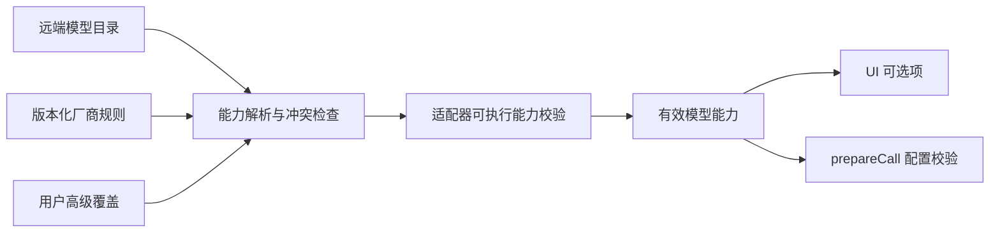

# 模型厂商统一协议与改造方案

状态：**统一协议与插件入口已实现，厂商接入分阶段推进**。调研日期：2026-10-21。调研代码基线：`fa0a9be1b3a67504230235d4292bd094ef2c0ed2`。

对应需求：统一七家厂商的思考控制；让用户选择厂商、填写必要连接信息和 API key 后获取模型，减少手工参数配置。官方字段、型号差异、列表接口与来源见 [能力矩阵](model-provider-capability-matrix-2026-10-21.md)。

## 已落地范围

- `llm` 提供 `ReasoningOptions`、三态有效能力及组合约束，以及 `LlmProviderContribution` 注册、发现、能力解析和适配器创建接口。Agent、Session 持久化与恢复、Local/Relay、子代理都传递统一意图；新请求写新字段，旧 `reasoningEffort` 只用于历史兼容。
- 生产连接均由 `LlmRuntime.createProviderAdapter` 创建。旧 `KoogLlmPlugin` 直接安装入口已移出生产代码，仅保留为旧测试夹具；旧 `OpenAiModelDiscovery` 已删除。Koog client/executor 留在插件内部复用，每个连接独立，重载保留原子替换与在途租约。
- 七家插件已注册。OpenAI、DeepSeek、百炼/Qwen、Kimi、智谱使用兼容协议适配；能力按已知型号和实际协议声明，未知型号不猜测思考参数。Claude、Gemini 本阶段提供模型发现，原生推理适配尚未接入，因此不允许保存为可推理连接。
- OpenAI、Claude、Gemini、DeepSeek、百炼/Qwen、Kimi 的模型发现已接入官方接口。智谱暂用明确标注来源与限制的预置目录，不声称 API key 或套餐权限已经验证。
- 设置页从插件读取厂商及入口预设，支持 API key → 获取目录 → 选择模型 → 保存；高级连接字段按需展开。目录事实与用户模型选择、覆盖配置分开，部分结果不能覆盖完整缓存；发现输出容量不会成为请求输出默认值。
- 通过 Desktop Host 更新同名凭据时，会先清除所有引用该凭据的发现快照与绑定，保留模型选择和覆盖配置；发现网络请求不阻塞凭据更新，提交时重新检查配置和凭据。限制：外部代码直接调用 `CredentialProvider` 改值时，目前仅保证进行中的发现结果失效，已持久化目录仍标为 `cached`，需要用户重新获取模型；尚未实现跨进程凭据版本与目录的自动失效绑定。

下文保留完整目标设计；类型示意以实际源码中的中立契约为准。后续阶段需要补齐 Claude/Gemini 原生请求、流和工具/replay 语义，以及各厂商尚未验证的模型或服务入口。当前验收使用离线 HTTP fixture，不等同于真实账号端到端验收。

## 1. 设计结论

采用 **对内统一能力、由厂商插件实现差异** 的边界。`llm` 定义中立契约和运行时规则；厂商插件向 Host 注册描述、发现策略、能力规则和适配器；`llm-koog` 保留为可复用的 SDK 桥接层。上层 Agent、Session、UI 只使用统一意图及有效能力，厂商插件可以复用 Koog，也可以实现原生 LlmAdapter。

优先改四件事：

1. 每个 provider 实例独立连接和 executor，保留现有原子重载与在途调用租约。
2. 思考协议从单一 reasoningEffort 扩展为模式、effort、预算等独立维度，按模型和协议校验组合。
3. 模型发现独立于推理 provider 的激活，支持零模型配置开始接入。
4. 将远端元数据、版本化模型规则和适配器实际能力合并，UI 只呈现真正可执行的选项。

第一版覆盖七家直连接入；百炼/GLM 的地区和服务类型有明确预设。Azure、Bedrock、Vertex、任意第三方网关自动识别、跨厂商自动故障转移、会话中途切换模型及完整远端设置页不纳入第一版。既有 Local/Relay 调用参数仍须一致传递，不能让新参数在 Relay 中丢失。

## 2. 调研基线与改造依据

以下记录改造前的行为。文件均相对仓库根目录，行号对应上述调研基线；不代表实现后的现状。

| 当前位置 | 现状 | 需要改变的行为 |
| --- | --- | --- |
| `modules/llm/.../LlmModel.kt`、`LlmTypes.kt:187` | reasoning 仅有 efforts/defaultEffort；调用只携带 reasoningEffort | 增加完整意图、能力与约束；模型上限、服务默认、用户调用默认分开 |
| `modules/llm/.../LlmRuntime.kt:410` | 未指定 effort 时回填 model defaultEffort | 区分继承与显式厂商默认；归一化后不再补回省略字段 |
| `modules/llm-koog-openai/.../client/OpenAiPromptExecutorFactory.kt:69` | 全部 provider 要共享 credential、base URL、timeouts，最终创建一个 client | 每个 provider 实例独立 executor/client |
| `modules/llm-koog/.../lifecycle/KoogLlmReloadCoordinator.kt:149` | 所有 provider ID 指向同一个新 generation | 构建 provider→generation 候选集合，成功后原子替换 |
| `modules/llm-koog/.../semantics/KoogProviderSemanticsRegistry.kt` | option/stream/tool/replay 按 api 分发 | 同时识别协议和厂商/服务语义；同为 OpenAI-compatible 也不能共用全部规则 |
| `modules/llm-koog-openai/.../chat/OpenAiChatOptionMapper.kt:138` | 固定接受 none/minimal/low/medium/high，另有型号分支 | 使用模型规则决定支持集合与 wire 编码 |
| `modules/llm-koog-openai/.../responses/OpenAiResponsesOptionMapper.kt:26` | 无条件拒绝 reasoningEffort | 实现实际 reasoning 参数；在实现前不向 UI 宣传支持 |
| `modules/llm-koog-openai/.../catalog/OpenAiKoogCatalog.kt:23` | Chat/Responses 共用目录快照，没有过滤上述差异 | 有效能力必须与协议 mapper 能力取交集 |
| `modules/llm-koog-openai/.../client/OpenAiModelDiscovery.kt` | 固定 Bearer、尝试 /v1/models 与 /models；只读 id/name/context_window；has_more=true 报错 | 按厂商注册 endpoint/auth/pagination/schema；保留有界响应、超时和脱敏错误处理 |
| `modules/bundle/desktop/.../DesktopProviderSettings.kt:212` | 对已存在 provider 直接调用 OpenAiModelDiscovery，并写入 models | 支持 draft connection 发现；发现缓存与用户选择/覆盖分离 |
| `modules/llm-koog/.../catalog/KoogModelCatalog.kt` | 未知模型会落到通用上下文/输出默认值 | 不把回退值伪装成厂商容量事实；unknown 与运行策略区分 |
| `apps/shared/.../settings/ModelSettings.kt`、`page/SettingsModelsPage.kt` | 配置字段多，思考只有字符串档位 | 厂商预设引导、条件字段、能力驱动控件 |

当前已有可复用的基础：中立 LLM Adapter、模型目录与活动路由分离、prepareCall 快照、generation lease/retire、严格配置 codec、凭据引用、发现结果提交前的 revision 检查。应扩展这些机制，避免另建一套并行运行时。

### 2.1 不能直接把多个 client 加进 SDK

本机 Koog **1.1.1** 的字节码核查显示：重复 provider 的 client 会进入 RoutingLLMPromptExecutor；默认 RoundRobinRouter 按 `LLModel.provider` 选择池并轮转。目前多个兼容厂商都映射成 `LLMProvider.OpenAI`，这不包含 Harness provider 实例身份。

因此直接调用多次 addClient 可能把同一请求分配到另一厂商/凭据。首版采用 **一个 Harness provider 实例对应一个 executor/generation**。SDK 虽有自定义 router 扩展点，但没有必要在本次另建模型身份桥接。

## 3. 统一身份与注册边界

```text
ProviderInstance
  id                  稳定、持久化的连接实例 ID
  vendor              openai / anthropic / google / deepseek / alibaba / moonshot / zhipu
  endpointProfile     官方地区、workspace、标准 API / Coding Plan 或明确的自定义入口
  protocol            openai-chat / openai-responses / anthropic-messages / gemini-...
  apiVersion          协议需要时设置，例如 Gemini v1/v1beta
  credentialRef       由现有凭据服务解析，不在普通 settings 中存明文
  connectionOptions   endpoint、timeout 等，仅高级入口暴露

ModelIdentity
  providerInstanceId + protocol + apiVersion + modelId + modelVersion?

CapabilityScope
  ModelIdentity + endpointProfileRevision + inferenceProvider? + rulesRevision
```

连接实例不是模型研发厂商。百炼托管 Kimi 的参数由百炼入口决定；两个相同 model ID、不同 key/base URL 的实例也必须独立。provider ID 不随显示名称修改，不允许删除后静默路由到另一实例。凭据值不进入能力键；发现缓存使用凭据引用的变更版本隔离。

Host registry 的拟新增接口：

```kotlin
interface ProviderDescriptor {
    val vendorId: String
    val connectionProfiles: List<ConnectionProfile>
    val protocolBindings: List<ProtocolBinding>
    val discovery: DiscoverySupport // documented / unverified / unavailable
}

interface ModelDiscoveryAdapter {
    suspend fun discover(connection: ResolvedDiscoveryConnection): CatalogSnapshot
}

interface ModelCapabilityResolver {
    fun resolve(identity: ModelIdentity, facts: ModelFacts): EffectiveModelCapabilities
}
```

以上为概念示意；实际契约分别为 `LlmProviderDescriptor`、`LlmModelDiscovery`、`LlmCapabilityRules`，通过 `LlmProviderContribution` 注册。Descriptor 由代码注册并声明所需连接字段，UI 不维护另一份厂商规则；不根据 key 外观或自定义 URL 猜测厂商，也不把 key 发送到多个厂商试探。

### 3.1 核心、插件与 UI 的职责

| 边界 | 统一负责 | 不应承接的职责 |
| --- | --- | --- |
| 中立契约与 Host 运行时 | 连接实例身份、模型目录格式、调用意图、有效能力、流式事件、工具调用、usage、错误；默认值合并、公共校验、注册与调用生命周期 | 厂商字段名、私有 endpoint、特定型号的参数换算 |
| 厂商插件 | 连接预设和必要字段、认证方案、发现接口与分页、模型规则、原生请求编码、流式与错误转换、私有 replay | 另建一套凭据持久化、会话存储或独立的上层配置优先级 |
| 共享协议/SDK 实现 | 可复用的 HTTP、SSE、消息编码与 SDK 桥接；由厂商插件明确选用 | 假设所有 OpenAI-compatible 服务具有相同能力和默认值 |
| UI / Agent / Session | 依照统一描述呈现、调用和保存意图；通过 Host API 消费有效能力 | 按 vendor 分支转换参数、维护另一份型号能力表 |

核心统一的是表达方式和行为约定，并不保证每个模型拥有相同能力。例如“关闭”“低强度”“指定预算”仍然是不同意图；插件声明支持集合及组合约束，不能静默将一种意图替换成另一种。

核心负责合并元数据与公共约束检查；插件贡献版本化型号规则和适配器可执行能力。需要完整 messages/tools 才能判断的协议约束，由插件在请求编码阶段继续校验，错误统一返回。新增厂商通常只增加插件注册和实现，不要求 Agent、Session、UI 新增厂商分支。

### 3.2 插件注册契约

建议以一个注册贡献对象聚合能力；以下为结构示意，不新增第二套插件加载系统：

```text
ProviderContribution
  descriptor           厂商名称、连接预设、所需字段、协议支持
  discovery?           可选模型发现实现；缺省时声明预置目录来源
  capabilityRules      型号事实补全、组合约束、规则版本
  adapterFactory       为单个连接实例创建 LlmAdapter / runtime
```

请求编码、流式转换、工具协议和私有 replay 属于 adapter 实现边界。插件注册的能力描述与 adapter 必须使用同一版本规则；运行时仍按第 5 节生成有效能力，避免“插件宣称支持但请求无法执行”。

注册接入现有 Context / EffectScope 生命周期：安装时注册 contribution；注销时撤销新发现/新调用入口，并按现有取消、lease/retire 规则释放资源。更新时先构建候选 contribution/runtime，再原子替换；已 prepare 的调用持有对应版本，不能切换到新 mapper。

**插件安装与连接实例分开。** 一个厂商插件可以管理个人 key、公司 key、自定义代理等多个实例；每个实例独立 endpoint、credentialRef、executor/generation 和发现快照。插件声明认证方式，实际凭据仍由 Host 的现有凭据服务解析。

### 3.3 模块与产品边界

- `llm` 保持厂商中立；ProviderContribution 等公共契约不能放在 `llm-koog-openai` 中迫使其他插件依赖 OpenAI 实现。
- `llm-koog` 是可选复用层。Claude/Gemini 等插件使用 Koog 还是原生 HTTP，由第 7.1 节的无损能力验证决定。
- OpenAI-compatible 厂商可以共享协议实现，但分别注册发现策略和型号语义。先拆清逻辑注册单元，不要求立即为七家创建七个物理模块；依赖、平台或发布边界有需要时再拆模块。
- 首版通过现有编译期 Catalog / bundle 装配插件；这一设计不隐含新增插件商店、运行时下载或通用脚本执行能力。
- UI 消费插件声明的有限连接字段和统一模型能力 DTO，生成必要表单与控件；不接收厂商私有原始响应，也不需要为每个厂商单独开发设置页。

具体调用路径：用户选择模型与思考意图 → 核心合并默认值并查验有效能力 → 选中连接实例的插件编码请求 → 厂商响应由插件转换为统一事件 → 核心交给 Agent/Session/UI。原生字段和私有 replay 始终留在插件与 Host 边界内。

## 4. 思考请求协议

### 4.1 归一化的调用意图

以下 Kotlin 为契约草图，序列化名称在实现时固定为稳定 wire schema：

```kotlin
sealed interface ReasoningMode {
    data object ProviderDefault : ReasoningMode
    data object Disabled : ReasoningMode
    data object Enabled : ReasoningMode
    data object Adaptive : ReasoningMode
    data class ProviderMode(val id: String) : ReasoningMode
}

data class ReasoningOptions(
    val mode: ReasoningMode = ReasoningMode.ProviderDefault,
    val effort: ReasoningEffortId? = null,
    val budgetTokens: Int? = null,
    val executionModeId: String? = null,
)
```

规则：

- 这是**配置合并后的意图**。ProviderDefault/null 表示不发送该维度的控制字段，不能解释成 off、adaptive、high 或预算 -1。
- Enabled 表示请求启用该模型所定义的思考行为，不保证每次都输出思考文本。是否支持该意图、如何编码，由具体模型规则决定。
- effort 继续使用开放的 ReasoningEffortId，不固定为全局三档，也不假设各模型同名档位消耗相同。
- budgetTokens 的范围由具体 BudgetRules 决定，0 没有全局关闭语义，例如 Qwen3.8 将 0 映射到 low。仅在 Gemini GenerateContent 明确支持 thinkingBudget 特殊值的型号上，将 Disabled/Adaptive 编码为 0/-1；2.5 Pro 不允许 Disabled，Interactions 不使用该转换。这些型号的 Adaptive 与显式数值预算争用同一字段，应作为冲突拒绝。
- effort 与 budget 是独立可选字段：Claude 特定型号允许组合，Qwen3.8 和部分 Gemini 组合不允许。Disabled + effort 也不全局禁止，因为 Claude effort 可影响整体输出。
- ProviderMode 只能引用注册且在该模型下支持的模式，例如 `anthropic:between_tools`；不是任意 JSON 透传口。
- executionModeId 表达 standard/pro 等独立控制，只有支持的模型才显示。不要把它折叠到 effort。
- 摘要显示与历史保留不混入“强度”。前者是独立输出展示能力，后者首版由适配器正确性规则管理；必要时再增加经校验的高级选项。

示例：

```json
{
  "provider": "deepseek-personal",
  "model": "<selected-model-id>",
  "reasoning": {
    "mode": "enabled",
    "effort": "high"
  }
}
```

这不是可直接提交给厂商的 JSON。适配器根据协议编码；同样的内部意图在 Responses、Chat 和原生协议有不同字段路径。

### 4.2 配置继承与厂商默认

配置合并阶段，每个维度使用三态：

| 状态 | 含义 |
| --- | --- |
| Inherit | 没有作出选择，继续继承应用/模型/会话配置 |
| ProviderDefault | 用户显式要求省略该维度，阻止更低优先级的本地默认回填 |
| Value(value) | 显式选择，经能力校验后编码 |

合并一次后才生成 ReasoningOptions。LlmRuntime 不再用 `requested ?: model.defaultEffort` 二次补默认。目录中的厂商默认仅供解释和展示，不自动变成实际发送值；用户自己配置的默认与它分开保存。UI 的“全部跟随厂商”在当前作用域对所有维度写入显式 ProviderDefault，阻止下层默认回填；“恢复继承”是另一操作。

### 4.3 能力与校验

```text
ReasoningCapabilities
  support: supported | unsupported | unknown
  modes: CapabilitySet<ReasoningMode>
  efforts: CapabilitySet<ReasoningEffortId>
  budget: Capability<BudgetRules>
  executionModes: CapabilitySet<String>
  constraints: List<ReasoningConstraint>
  documentedDefaults: 可选，仅展示与诊断
  evidence: 字段来源、适用范围、核验时间、规则版本

BudgetRules
  min / max / step?
  enforcement: hard_limit | advisory | unknown
  relationToOutputLimit: 模型及模式相关约束
```

CapabilitySet 也要区分已知空集合与未知集合。约束使用 Host 内的类型化规则，如 mode 与 effort 的允许组合、effort/budget 互斥、预算与输出上限关系、采样字段限制、工具调用与 replay 要求；不执行远端目录提供的任意逻辑。

用户未设置且能力未知：保持省略。用户显式选择但能力未知：返回可辨识的 `CAPABILITY_UNKNOWN`；明确不支持或冲突则返回 `UNSUPPORTED_REASONING_OPTION` / `INVALID_REASONING_COMBINATION`。**不能悄悄忽略、降低强度或自动关闭后宣称成功。** 高级自定义模型要先提供可验证的能力覆盖，并且适配器能够编码。

模型容量 `maxOutputTokens`、用户请求 `maxTokens`、思考预算三个概念分开。厂商输出字段计算 answer_only 还是 reasoning_and_answer 必须进入能力说明和 mapper；在口径不等价时不能承诺“同样数字就有相同语义”，也不能用减法猜剩余回答空间。

## 5. 能力合并与运行时快照



合并不是简单的“后者覆盖前者”：

1. 远端明确返回的能力事实保留来源与作用域；内置规则补缺失字段及跨参数约束。
2. 远端与同版本规则冲突时，记录 conflict；对有争议的显式控制停止宣传可用，等待更新规则或经验证的覆盖。
3. 用户覆盖用于私有网关/自定义模型；覆盖不能让未实现的 mapper、工具协议或 replay 凭空变为支持。
4. 最终与适配器已实现且验证过的能力取交集。模型支持图片但当前请求链不支持图片时，分别记录 model capability 与 runtime capability。
5. 内置目录只说明官方存在该模型，不能伪装成当前 key 的可用模型。远端也可能返回平台公共目录，目录可见性与账户调用权限仍然分开。
6. 不用模型名前缀猜能力，不把 unknown 的容量补成 262144/32768 并标为事实；确有运行时兜底策略时应单独标记其来源和保守性。

prepareCall 固定有效调用配置、能力/规则版本、mapper 和 client generation，继续使用现有 lease。它当前尚未接收 messages/system/tools，因此不能声称此时已经固定完整 HTTP 请求。最终编码在组装 GenerateOptions 后完成，仍使用已捕获的规则与 generation；不得重读全局最新设置。

会话记录保存用户意图、已解析配置与规则版本。历史恢复后用当前可用适配器重新验证；无法兼容时明确失败，不静默改档。provider_default 只能保证本地不补参数，不能保证远端模型别名或服务默认永远不变。

## 6. 模型发现、保存与 UI 流程

### 6.1 首次接入

```text
选择厂商/服务预设
  → 仅询问必要的地区、workspace 或服务类型
  → 输入 key（Host 凭据服务管理引用）
  → 使用草稿连接获取完整模型目录
  → 合并能力并区分 Agent 可用模型
  → 保存连接及完整目录；新模型默认开启
  → 在模型管理中用开关控制可选项、点击行设置新会话默认模型
  → 输入框按会话选择模型与思考强度
```

发现不依赖当前 active adapter，也不要求先手工输入 model ID。provider route 的非空模型约束可在激活阶段保留；draft/discovery 使用独立的连接类型。七家的具体 endpoint/auth/pagination 见能力矩阵，不能继续统一猜 `/v1/models`。

普通用户只看到厂商、必要连接字段、key、模型。base URL、协议、timeouts、能力覆盖等放入高级配置，采用预设默认值。GLM 首版显示预置目录及未验证状态，保留手工 ID；不显示已成功在线获取。

### 6.2 发现结果契约和持久化

```text
CatalogSnapshot
  scope: providerInstance / endpointProfile / protocol / credentialRevision
  revision / fetchedAt / source
  completeness: complete | partial
  models: List<ModelDescriptor>
  warnings / continuation?

ModelDescriptor
  id / displayName / version? / lifecycle?
  limits / modalities / supportedOperations
  reasoningFacts / provenance
  catalogVisibility: listed | absent_from_catalog | unknown
  documentedLifecycle: active | deprecated | retired | unknown
  lastInferenceVerification: 可选，记录时间、入口/凭据版本、结果与失败原因
```

实现规则：

- 拉齐分页，限制页数/总条数/响应大小并检测 cursor 循环；遇到中途失败返回 partial，不当作完整目录替换旧快照。
- 网络完成后检查 provider 配置和 credential revision；用户已经改 key、地区或 endpoint 时丢弃旧结果。保留当前代码已有的 revision 防护。
- 将 discovery cache、用户选择的模型、用户覆盖和调用默认分开保存。刷新目录不覆盖用户自定义配置。
- 完整成功空列表是有效结果；标明没有发现模型，保留用户配置和旧会话。不能继续把旧缓存宣称为本次实时结果。
- 完整目录中未出现的模型标记 absent_from_catalog，不能仅凭缺席断定不可调用；保留历史验证及其时间。官方明确 retired/关闭日期已生效，或有明确不可调用证据时才据其作用域标记不可用。不自动删除历史会话，也不替换成其他厂商模型。
- 权限、限流、网络、分页失败分别报告；缓存回退明确显示时间与来源。列表获取成功不显示“推理验证通过”。
- key 只通过现有 Host 凭据服务写入和解析；草稿生成内部 credentialRef，用户不用手填引用名。取消时只清理该草稿新建且未被使用的凭据，不触碰既有凭据。

Host 提供 registry/discovery/有效能力；Shared UI 通过现有 ModelSettingsBackend 边界消费 DTO。Agent 可用筛选以当前适配器的文本生成、流式与工具能力为依据；embedding/image-only 等可留在完整目录，但不进入 Agent 模型选择器。

### 6.3 模型管理与输入框交互（2026-10-22）

- 设置入口统一为“模型管理”。先选择厂商连接配置，再管理其模型列表；保留连接添加、编辑、删除和目录获取、更新操作。
- 发现结果与手工模型合并提供路由，旧单选模型不再限制发现目录。新模型默认开启；disabledModelIds 独立保存，更新不重置开关。
- 模型行背景深浅表达新会话默认选择，开关只控制输入框可见性。点击开关不触发行选择；关闭默认模型清除默认值，已有会话保留引用并要求重新选择。
- 输入框汇总各连接已开启的聊天模型，保持平铺列表；同名模型附连接名称以区分。
- 弹层采用栈导航：入口打开思考强度 → 点击上方模型压入模型列表 → 选中模型后出栈回到思考强度。返回取消本次浏览，点击外部关闭全栈。
- 没有可调整强度的模型仍回到思考组件并显示说明。切换模型时验证原思考设置，不兼容则使用厂商默认。
- 会话选择独立于新会话默认值。每次后续消息携带模型与思考配置，入队时保存，执行整个 turn 时固定；恢复会话读取持久化请求配置。
- 完整刷新中消失的模型保留为“最新目录未列出”；不完整刷新不替换旧目录。开关不删除运行时路由或历史记录。

### 6.4 思考控件

默认显示“跟随厂商”；支持时显示关闭/自动/模式选择和该模型真实 effort 集合。预算、特殊模式在支持时提供高级控件，不要求每个用户填一组原生字段。模型切换时重新校验已有意图，提示不兼容项，不将旧预算或档位静默套入新模型。

## 7. 具体代码改造清单

文件缩写 `...` 代表该模块现有 `src/im/hikaru/harness/...` 包路径，不是新目录。类名和拟新增职责如下：

| 模块 / 文件 | 改造内容 |
| --- | --- |
| `modules/llm/.../LlmModel.kt` | 新增 ReasoningCapabilities、Evidence、约束与限额语义；保留 provider-neutral 边界 |
| `modules/llm/.../LlmTypes.kt`、`LlmRuntime.kt` | ReasoningOptions 贯穿 LlmCallConfig/GenerateOptions；一次归一化与校验；捕获规则快照；扩大 PreparedLlmCall 的一致性检查 |
| `modules/llm-koog/.../config/KoogProviderSettings.kt`、`KoogLlmSettingsJsonCodec.kt` | 新增 vendor/endpointProfile/版本字段；扩充严格允许字段；分开能力、调用默认和用户覆盖 |
| `modules/llm-koog/.../catalog/KoogModelCatalog.kt` | 合并来源和运行时能力，去除对未知容量/思考能力的事实性猜测 |
| `modules/llm-koog/.../lifecycle/KoogLlmReloadCoordinator.kt`、`KoogLlmGeneration.kt` | provider 独立 generation；完整构建候选集，再原子提交；失败关闭新资源并保留旧集；保留 retire/lease |
| `modules/llm-koog/.../semantics/KoogProviderSemanticsRegistry.kt` | 以 protocol + vendor/service semantics 分派 option/message/tool/replay/usage 等逻辑 |
| `modules/llm-koog-openai/.../client/OpenAiPromptExecutorFactory.kt` | factory 输入限定单 provider；保留 endpoint 校验及 SDK retry/fallback 关闭策略 |
| `modules/llm-koog-openai/.../chat/OpenAiChatOptionMapper.kt`、`responses/OpenAiResponsesOptionMapper.kt` | 按已解析规则编码参数；补 Responses reasoning；校验采样、工具、输出字段冲突 |
| `modules/llm-koog-openai/.../client/OpenAiModelDiscovery.kt` | 实现 discovery 接口，作为 OpenAI 发现策略；不再冒充所有兼容厂商通用目录 |
| 厂商语义与发现实现（拟新增） | DeepSeek/Qwen/Kimi/GLM 可复用已验证的 OpenAI wire 编码，分别实现规则、发现与历史处理；Claude/Gemini 独立原生协议插件 |
| `modules/bundle/desktop/.../DesktopProviderSettings.kt` | 移除直接 new OpenAiModelDiscovery 与硬编码厂商选项；编排 draft、credential、发现缓存、revision 检查和保存 |
| `apps/shared/.../settings/ModelSettings.kt`、`page/SettingsModelsPage.kt` | 预设向导与能力 DTO，按需显示地区/workspace；基础表单只呈现必要项 |
| `apps/shared/.../app/ComposerPresentation.kt`、`ConversationComposerToolbar.kt`、`HarnessApp.kt` | 将单 effort 列表升级为能力驱动；模型选择变化触发意图校验 |
| `modules/agent/.../AgentTypes.kt`、`modules/agent-loop/.../AgentLoopAgent.kt` | 新意图从 AgentOptions 进入 prepareCall、GenerateOptions 和 request/header |
| `modules/session/.../SessionEventTypes.kt`、`modules/session-api/.../SessionApi.kt` | 持久化新配置；恢复和编辑分叉保留意图与规则信息 |
| `apps/shared/.../connection/Connection.kt`、`apps/jvm-app/.../connection/LocalConnection.kt`、`HostRelayConnection.kt`、`modules/api/gateway/.../SessionApiGateway.kt` | 更新协议 DTO 和 Local/Relay 映射；保持 contracts 不依赖运行时实现 |
| `modules/subagent-tools/.../SubagentToolHandler.kt` | 明确父配置继承和子代理覆盖，子代理不能丢失预算、模式或显式厂商默认 |

### 7.1 SDK 适用性验证

当前 Koog 1.1.1 的 OpenAI 参数类型有 additionalProperties，Anthropic client 也有 thinking 类型，但这不证明本项目已支持目标 wire schema，更不证明签名、原始块、流式历史能无损往返。当前依赖缓存中也未核实 Gemini client 的版本能力。

实施时先用本地 HTTP fixtures 验证最终 JSON、SSE 与 replay。能无损表达则复用 Koog；不能表达则在对应厂商插件使用最小原生 HTTP LlmAdapter，并复用同一中立契约和生命周期要求。不要把字段放进一个 SDK 不序列化的 metadata map 就宣布完成。Claude/Gemini 的具体传输实现选择由这一步结果决定，上层协议不变。

### 7.2 历史与工具循环

除可显示的 Reasoning 文本外，保存版本化的 provider 私有 replay state，包含来源实例、协议/版本、模型兼容身份和原始块。Claude signature/redacted_thinking、Gemini thoughtSignature/steps、OpenAI encrypted reasoning、兼容厂商 reasoning_content 的顺序与工具关联都须保留。

不要在 UI DTO 暴露私有 replay；它属于 Host 持久化和适配器恢复边界。继续沿用现有 Responses replay seam，不能跨厂商复用同一份状态。压缩、编辑旧消息、改 system/tools、切换模型前必须按厂商规则判断是否还能重放；无法保证时明确处理，不能只保留可见思考文本。

## 8. 旧配置与会话兼容

1. 保留 `llm-koog` settings namespace 与 `providers.<id>`；api 暂继续表示 protocol，新增 vendor 等字段。旧配置缺省采用当前 OpenAI 语义，不猜 URL 所属厂商。
2. 旧 reasoningEffort 在读取时迁移成新 effort 意图；none 的解释保留原协议语义，不能跨厂商统一改为 Disabled。新旧字段同时存在且冲突时明确报错。
3. 旧 `reasoningEfforts=false` 表示能力禁用，不是当前请求默认关闭；数组/同值映射对象仍表示能力集合。wire 字段转换留在 mapper，不放开任意 alias 绕过校验。
4. 给 settings 和 request/header JSON 确定版本及读取迁移策略，新 reader 能读旧记录；旧 reader 遇到新版本须明确提示不兼容，不能宣称双向兼容。
5. 当前模型选择存于 request/header JSON，不在 Room 独立模型列里。优先处理 JSON reader/writer，而非假设必须增表；`SessionJson` 和 Room 读取器当前都严格拒绝未知字段。
6. 用户默认与厂商 documented default 分离时必须保留旧配置行为，并记录迁移来源；新建配置默认使用真正的 ProviderDefault。

## 9. 实施阶段与验收

| 阶段 | 交付 | 核心验收 |
| --- | --- | --- |
| P0：验证基线 | 固定 SDK 与目标协议；HTTP/流式 fixtures；修复目录与现有 mapper 宣称能力不一致 | Responses 不再出现 UI 可选而 mapper 必拒绝的 effort；确定哪些传输需原生实现 |
| P1：实例隔离 | 单 provider executor/generation，保留原子替换、回滚和租约 | 同名模型、不同 endpoint/key 并发绝不串线；重载中旧调用可完成，新调用用新连接 |
| P2：统一契约 | 意图、三态继承、能力规则、序列化及完整调用链 | 默认/关闭/自动不混淆；Claude 双参数允许、Qwen/Gemini 互斥生效；Local/Relay/子代理/恢复一致 |
| P3：发现与目录 | 注册式 discovery、完整分页、缓存来源、草稿连接 | 新用户零手填模型可发现；过期响应不覆盖新 key 配置；GLM 未验证状态准确可见 |
| P4：七家适配 | 逐家完成请求、流式、工具与 replay；Claude/Gemini 原生协议 | 允许的控制组合有精确 wire fixtures；多轮工具往返不丢原始思考/签名；未知能力不冒充可用 |
| P5：产品接入 | 预设向导、能力控件、清晰失败与缓存状态 | 普通用户只填必要连接项；模型切换不静默降级；高级配置仍能表达自定义入口 |

P2 与 P3 的部分工作可并行，但完整七家接入验收依赖 P1/P2/P4；仅实现模型列表并不代表推理接入完成。首版不要求所有阶段都在一个 PR 中交付，每一阶段应可独立回归。

拟扩展现有测试，而非只测试数据类字段：

- `LlmRuntimeTest`：继承/显式省略/显式值、未知能力、组合冲突、prepareCall 快照。
- `KoogLlmDynamicSettingsTest` 和生命周期测试：同名模型实例隔离、候选构建失败回滚、取消/重载资源释放。
- `OpenAiModelDiscoveryTest` 及厂商发现 fixtures：分页、cursor 循环、null 元数据、完整空目录、401/403/429、中途失败和 revision 竞争。
- `OpenAiLocalHttpTransportTest`/厂商 HTTP fixtures：断言最终请求字段，不只断言 mapper 对象；包含禁发字段、默认省略与协议大小写。
- replay/tool integration tests：连续多次工具调用、完整签名顺序、流式拼装、恢复与来源不匹配处理。
- Session/Local/Relay/子代理契约测试：旧事件读取、新事件版本门控、默认值不被重复填充。

真实厂商调用是后续带凭据的验收步骤，应记录日期、入口、型号和协议；本次只做文档与代码核查，没有调用真实推理接口，也没有运行产品测试。

## 10. 待核验项与完成定义

- GLM 公开模型发现稳定契约仍未知：可完成预置目录路径，不能承诺已实现在线发现。
- 百炼个别型号默认值与通用参数说明存在差异：按型号/协议维护冲突状态，实测或官方澄清后启用相应显式控制。
- SDK 对各厂商原始 replay 的支持需 P0 fixtures 确认：参数能发送不等于 Agent 工具循环能正确执行。

本需求的完成标准是：**用户通过必要的连接信息得到来源明确的模型目录，选中模型后能使用其真实支持的思考选项；这些选项在调用、工具循环、热更新和会话恢复中语义一致。**
